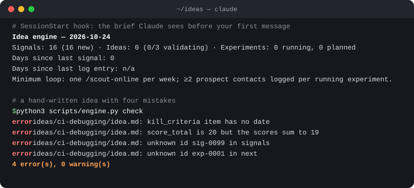
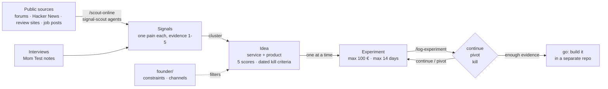

<div align="center">


# Panlode

**Evidence before code. A Claude Code workspace that finds real customer pain, turns it into startup
ideas and kills the weak ones with cheap experiments, before you build anything.**

<sub>*Panlode*: pan the stream for signs of the lode before you dig the mine.</sub>

[](https://github.com/milosCvetkovicDev/panlode/actions/workflows/ci.yml)
[](LICENSE)
[](https://www.python.org/)
[](template/scripts)
[](https://code.claude.com/docs/en/overview)

[Quick start](#quick-start) · [How it works](#how-it-works) · [A real run](#a-real-run) ·
[Docs](https://miloscvetkovicdev.github.io/panlode/) · [FAQ](#faq)

</div>

---

Most side projects die the same way: a good weekend of code, then silence, because nobody needed it.
Panlode flips the order. Claude Code subagents read public forums, review sites and job boards for
**signals**: people describing a problem, ideally one they already pay to work around. Signals that
cluster become an **idea** with a service you could sell by hand this month and the product it could
become. Each idea then runs **one cheap experiment at a time** (at most 100 € and 14 days) that ends in
`continue`, `pivot` or `kill`. Ideas are ranked by **speed to the first paying customer**, not by the
size of the market.

Everything is plain Markdown in a git repository you own. A small Python engine with no dependencies,
wired into Claude Code hooks, checks every record as it is written, so the rules hold even when the
agent is in a hurry.

<p align="center">
  
</p>

## Contents

- [Why](#why)
- [Quick start](#quick-start)
- [Commands](#commands)
- [How it works](#how-it-works)
- [What you get](#what-you-get)
- [The rules the engine enforces](#the-rules-the-engine-enforces)
- [A real run](#a-real-run)
- [What it is not](#what-it-is-not)
- [Limits](#limits)
- [FAQ](#faq)
- [Contributing](#contributing) · [License](#license)

## Why

AI coding agents made building cheap. They did not make *knowing what to build* cheap, and a
coding agent left alone will happily build the wrong thing very fast. Panlode points the same agent at
the step that usually gets skipped:

- **Evidence, scored.** Every signal links to the page it came from and carries an evidence score from
  1 (one anonymous complaint) to 5 (proof that people already pay for a worse alternative).
- **Kill criteria with dates.** An idea cannot enter validation without dated conditions under which it
  dies. Most ideas should die, early and cheaply.
- **A hard WIP limit.** At most three ideas are being validated at once.
- **A floor, not a schedule.** One scouting run a week and two prospect contacts per running experiment.
  The session brief counts the days since each, and Claude says so once either passes seven.
- **Founder fit filters, never generates.** Your constraints and channels decide which ideas you can
  sell; they are never the source of an idea. Ideas come from observed pain.

## Quick start

You need [Claude Code](https://code.claude.com/docs/en/overview), `git` and Python 3.10 or
newer as `python3`. Nothing else: no packages, no servers, no API keys beyond Claude Code's own.

**As a Claude Code plugin** (Claude Code 2.1.295 or later), in any Claude Code session:

```text
/plugin install panlode --marketplace milosCvetkovicDev/panlode
/panlode:init ~/ideas
```

**Or with git**, from your shell:

```bash
git clone https://github.com/milosCvetkovicDev/panlode.git
panlode/install.sh ~/ideas          # copies template/ into ~/ideas; never overwrites a file
```

Either way, `cd ~/ideas && git init`, fill in the three short files in `founder/` (who you are, what
you will not do, where you can reach people), start `claude` in `~/ideas` and run:

```text
/scout-online
```

Up to three `signal-scout` agents sweep one source recipe each (Reddit and forums, review sites,
freelance and job posts) and bring back candidate signals. You check them; Claude writes the ones you
keep. When signals cluster, shape an idea from `templates/idea.md`, plan an experiment from
`templates/experiment.md`, and log every contact with `/log-experiment`.

The plugin adds only the two setup commands; it installs no hooks of its own, so your other projects
are untouched. The workspace's hooks live in `~/ideas/.claude/settings.json` and run only there.

Step by step, with what each file is for: [Getting started](docs/getting-started.md).

## Commands

| Command | Where | What it does |
|---|---|---|
| `/panlode:init [folder]` | any session (plugin) | Sets up a workspace in an empty folder. Never overwrites a file. |
| `/panlode:update [folder]` | any session (plugin) | Refreshes the engine, skills, rules and templates. Never touches records, `founder/`, `CLAUDE.md` or settings. |
| `/scout-online` | workspace | Sends up to three `signal-scout` agents, one per source recipe, and writes the signals you keep. |
| `/log-experiment` | workspace | Appends a dated contact or result to an experiment; closes it with `continue`, `pivot` or `kill`. |
| `python3 scripts/engine.py check` | workspace shell | Every error and warning across all records; exits 1 on an error. |
| `python3 scripts/engine.py brief` | workspace shell | The session brief: counts, WIP and days since the last signal and log entry. |
| `python3 scripts/engine.py next-id sig` | workspace shell | The next free id (`sig`, `idea` or `exp`). |
| `python3 scripts/engine.py slug '<title>'` | workspace shell | An ASCII file-name slug. |
| `install.sh [--force] [--dry-run] <folder>` | your shell (git clone) | What the two plugin commands run. |

## How it works



Four Claude Code hooks call the engine, so the rules are enforced by code rather than by the prompt:

| Hook | What the engine does |
|---|---|
| `SessionStart` | Prints the brief: counts, WIP, days since the last signal and the last experiment log. |
| `PreToolUse` (Write, Edit) | Refuses product code in the workspace, hand edits to the generated `INDEX.md`, and a write that would overwrite a record with a different id. If `python3` is missing or too old, the write is blocked too. |
| `PostToolUse` (Write, Edit) | Validates the record just written and shows any error to Claude at once; regenerates `INDEX.md`. |
| `Stop` | Runs the full check before Claude finishes, and blocks once if errors remain (files written through the shell skip the per-file check). |

The design, module by module: [Architecture](docs/architecture.md). The vocabulary (signal, cluster,
idea shape, evidence, kill criteria): [Concepts](docs/concepts.md).

## What you get

`install.sh` copies [`template/`](template) into a folder of your choice:

| Path | What it is |
|---|---|
| `CLAUDE.md` | The workspace contract Claude reads every session: pipeline, weekly loop, invariants, language. |
| `.claude/skills/scout-online/` | `/scout-online` and three source recipes (forums, review sites, freelance and job posts). |
| `.claude/skills/log-experiment/` | `/log-experiment`: append a dated contact or result; close an experiment with a decision. |
| `.claude/agents/signal-scout.md` | A read-only subagent that sweeps one recipe and returns at most 8 candidates with links. |
| `.claude/rules/` | Path-scoped rules for signals, ideas and experiments, loaded only when Claude works in that folder. |
| `.claude/settings.json` | The four hooks, plus web access pre-approved for the sites the recipes read. |
| `scripts/engine.py` | The engine: `check`, `index`, `brief`, `next-id`, `slug`, `hook`. Standard library only. |
| `templates/` | Signal, idea, experiment and interview templates. |
| `founder/` | Your profile, constraints (budget, vetoes) and channels, with placeholders to fill in. |

## The rules the engine enforces

1. An idea lists at least one existing signal.
2. IDs (`sig-`, `idea-`, `exp-` plus four digits) are unique, well formed and resolvable.
3. At most three ideas are `validating` at once.
4. Every experiment has a deadline; a `done` experiment has a `result` and a `decision`.
5. `score_total` equals the sum of the five scores (pain, reach, willingness to pay, speed, fit).
6. File names are lower-case ASCII, generated by `engine.py slug` (accented Latin letters are folded,
   so `Größe` becomes `grosse`).

Experiments over 100 € or longer than 14 days are warnings, not errors: a breach is allowed, as a
conscious choice written in the record.

## A real run

[`examples/first-scout-run/`](examples/first-scout-run) holds the signals of the first `/scout-online`
run, on 2026-10-24, as they were written (only links to older, unpublished signals were removed):
16 signals from Upwork, Freelancer, PeerSpot reviews, Hacker News, DEV, Microsoft Q&A and a job board, each with its source link and an evidence score of 1 or 2. They
fall into three clusters: debugging CI pipelines, managing secrets and credentials, and upgrading
legacy JavaScript. None was strong enough to shape an idea yet, which is the point: the engine says
so instead of letting a hunch through. The example passes `engine.py check` in CI.

```text
$ python3 template/scripts/engine.py --root examples/first-scout-run check
0 error(s), 0 warning(s)
```

## What it is not

- **Not an idea generator.** It never invents ideas from your skills or from trends; it records pain
  that someone actually wrote down, with the link.
- **Not a scraper.** Scouts read public pages through Claude Code's web tools, a handful of pages per
  run, and paraphrase. No bulk collection and no personal data: businesses and public roles only.
- **Not a CRM or a product.** It is a folder of Markdown files with a checker. Build what passes in a
  separate repository; the workspace refuses product code.

How it compares with AI idea generators, validation canvases, social listening tools and spreadsheets:
[Compared with other approaches](docs/comparison.md).

## Limits

- Scouting quality is the quality of public text: forums over-represent developers and loud complaints.
  Evidence scores 1-2 are leads, not demand. Interviews and pre-sales are what move a score to 4-5.
- Web search and fetch results vary by region and day; a run is not reproducible.
- Budgets are in euros, and the limits (100 €, 14 days, 3 ideas) are constants in
  `scripts/ideaengine/schema.py` and `workspace.py`, not settings.
- The engine reads a deliberately small YAML subset (flat keys, inline or block lists). Nested maps
  are rejected rather than half-parsed.

More: [Limits](docs/limits.md).

## FAQ

**Does it need an API key or a paid service?** No. It runs inside Claude Code and uses its built-in
web search and fetch tools. The engine is standard-library Python.

**Can I write records in another language?** Yes. Set the conversation language in the workspace
`CLAUDE.md`; the skills report in it. File names stay ASCII; the slug helper folds accented letters.

**Can I use it without Claude Code?** The engine works on its own (`check`, `index`, `brief`), and the
records are plain Markdown. The scouting and the hooks need Claude Code.

**Why Markdown and git instead of a database?** Records are diffable, reviewable, greppable and yours.
`git log` is the audit trail of every decision, including the ideas you killed.

**Why rank by speed to the first paying customer?** Because a solo founder runs out of time before
running out of market. A small offer someone pays for this month beats a large one nobody has paid for.

More questions: [FAQ](docs/faq.md).

## Contributing

Issues and pull requests are welcome. Read [CONTRIBUTING.md](CONTRIBUTING.md) first; the short version:
standard library only, tests first, and `python3 -m unittest discover -s tests -t .` must pass.
Security reports: [SECURITY.md](SECURITY.md).

## License

[MIT](LICENSE). If Panlode helps your work, a citation is welcome: see [CITATION.cff](CITATION.cff).
