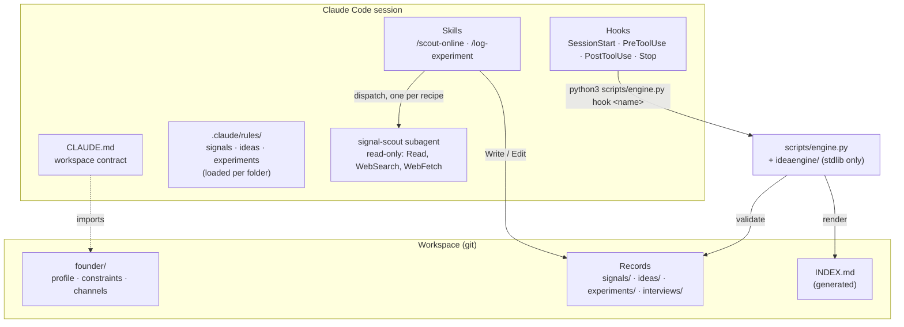

# Architecture
{: .no_toc }

Plain Markdown records, a small engine that checks them, and Claude Code features that call the engine
at the right moments.
{: .fs-6 .fw-300 }

1. TOC
{:toc}

---

## The layers

| Layer | Role | Why it is separate |
|---|---|---|
| `CLAUDE.md` | The pipeline, the weekly floor, the invariants, the language. Imports `founder/constraints.md`. | Read every session; short on purpose. |
| `.claude/rules/*.md` | Field rules for each record type, with `paths:` frontmatter. | Loaded only when Claude touches that folder, so the context stays small. |
| Skills | `/scout-online` and `/log-experiment`, each with a narrow `allowed-tools` list. | Repeatable procedures, invoked by you (`disable-model-invocation: true`). |
| `signal-scout` | One recipe per agent, returns at most 8 candidates as YAML. Tools: `Read`, `WebSearch`, `WebFetch`. | Scouts read untrusted pages; they cannot write anything. |
| Hooks | Call the engine before and after each write, at session start and at stop. | Rules enforced by code, not by the model remembering them. |
| Engine | Parses, validates, indexes, briefs. | Testable without Claude, runnable by hand and in CI. |

## The engine

`scripts/engine.py` is a thin CLI over the `ideaengine` package. Every command takes `--root DIR`
(default: the workspace that holds `scripts/`).

| Command | Does |
|---|---|
| `check [--file PATH]` | Validate every record; print errors and warnings; exit 1 on any error. |
| `index` | Regenerate `INDEX.md` (ideas, experiments, open signals, interviews). |
| `brief [--today YYYY-MM-DD]` | Print the session brief. |
| `next-id sig\|idea\|exp` | Print the next free id. |
| `slug TEXT...` | Print an ASCII file-name slug (accents folded, at most 60 characters). |
| `hook NAME` | Hook entry point: reads the event JSON on stdin, answers in Claude Code's hook format. |

| Module | Responsibility |
|---|---|
| `frontmatter.py` | Parses the flat YAML subset: `key: value`, `key: [a, b]`, `key:` with `  - item` lines, full-line comments. Rejects nested maps and duplicate keys with a line number. |
| `schema.py` | Field types and allowed values per record type, file-name patterns, conditional requirements (`cluster` when clustered, `next` and dated `kill_criteria` when validating, `result` and `decision` when done), and the warnings (budget, deadline). |
| `workspace.py` | Loads all records, checks ids for uniqueness and form, resolves every reference, enforces the WIP limit. |
| `report.py` | Renders `INDEX.md` and the brief (days since the last signal and the last experiment log entry, overdue experiments). |
| `hooks.py` | The four hook handlers. |
| `text.py` | Slugs: Latin letters without a Unicode decomposition mapped first (`đ`, `æ`, `œ`, `ø`, `ł`, `þ`, `ð`), then NFKD and case folding (`ß` becomes `ss`). |

Standard library only, Python 3.10 or newer. The engine's own unit tests live in `scripts/tests/` and
run in every workspace: `python3 -I -m unittest discover -s scripts/tests -t scripts`.

## The hooks

`.claude/settings.json` wires each event to `python3 "$CLAUDE_PROJECT_DIR/scripts/engine.py" hook <name>`.

| Event | Handler | Blocks? |
|---|---|---|
| `SessionStart` | Adds the brief to Claude's context; appends an error count if the check fails. | No |
| `PreToolUse` on `Write` and `Edit` | Denies: hand edits to `INDEX.md`; product code (`.ts`, `.js`, `.go`, `.rs`, `.java`, `.cs`, `.tf`, `.sql`, `package.json`, lockfiles, Dockerfiles...); a `Write` that would replace a record holding a different id. Asks you to confirm a write to `scripts/`, `.claude/`, `.git/` or `.mcp.json`, even in `acceptEdits` and bypass modes: the engine the hooks call, Claude Code settings, git hooks and MCP servers all run later without a prompt. The workspace is matched by identity, so another spelling of its path (case on macOS) does not count as outside. Paths outside the workspace pass. | Yes: Claude sees the reason for a deny, you see it for an ask |
| `PostToolUse` on `Write` and `Edit` | Validates the written record; regenerates `INDEX.md`. Errors go back to Claude at once; warnings are added as context. | Reports, so Claude fixes it before moving on |
| `Stop` | Regenerates `INDEX.md`; runs the full check; blocks once if errors remain, listing up to 20. Never blocks twice in the same stop cycle. | Once |

Files written through the shell skip `PreToolUse` and `PostToolUse`; the `Stop` check is the safety net
for them. A crash inside a hook is shown to Claude rather than swallowed.

Every hook command starts with `[ -f "$CLAUDE_PROJECT_DIR/scripts/engine.py" ] || exit 0`. Without it, a
folder holding the settings but not the engine (an interrupted install, a moved `scripts/`) would refuse
every write and every stop, because `python3` exits 2 on a missing script and Claude Code reads exit 2 as
a block. The opposite case fails closed: the `PreToolUse` hook sets `"onFailure": "block"`, so when the
engine is there but cannot start (no `python3`, or one older than 3.10), writes are refused rather than
let through unchecked (Claude Code 2.1.295 or later). An unknown hook name, as from a `settings.json`
older than the engine, exits 1 with a message instead of argparse's 2.

## Invariants

1. An idea lists at least one existing signal.
2. IDs (`sig-`, `idea-`, `exp-` plus four digits) are unique, well formed and resolvable.
3. At most three ideas are `validating` at once.
4. Every experiment has a deadline; a `done` one has `result` and `decision`.
5. `score_total` equals the sum of the five scores.
6. File names are lower-case ASCII slugs, with the date or id prefix their folder requires.

## Design choices

- **Markdown and git, not a database.** Records are diffable and reviewable, and `git log` is the audit
  trail of every decision, including the ideas you killed.
- **A YAML subset, not YAML.** A full YAML parser would be a dependency, and nested structures invite
  records nobody can read at a glance.
- **Scouts cannot write.** Page text is untrusted input. The scouts return candidates; the session that
  writes records only takes fields from them and never follows instructions inside them.
- **Warnings for budget and time, errors for structure.** Spending 120 € on a test can be a good call;
  an idea pointing at an experiment that does not exist is never one.
- **An installer, not a plugin.** `CLAUDE.md`, path-scoped rules and project hooks are workspace
  files; `install.sh` copies them and `--force` updates the engine parts without touching your records.
